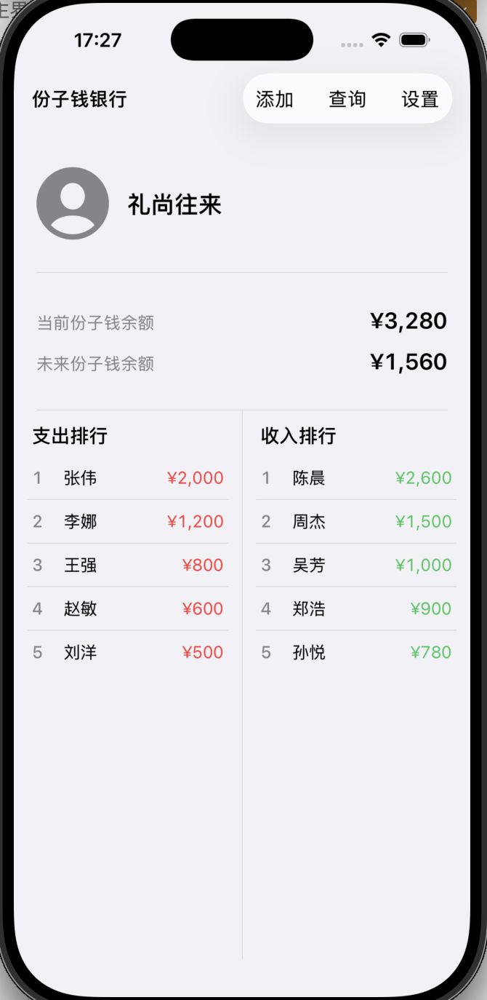
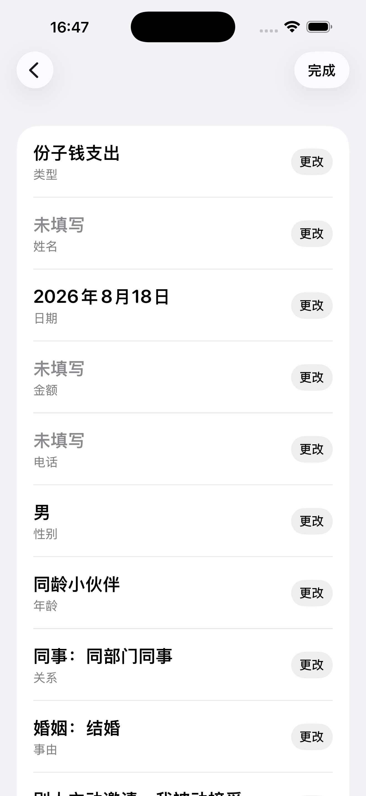

# 个人介绍

本人2013年以网络工程专业毕业，一直在从事信息化建设和网络信息安全管理工作，目前持有 CISSP CISP CDGA 证书，对于软件开发了解有限，在大学时进行了软件开发的学习，在工作中会用到脚本，相对熟悉的开发语言是 python c js php，没有大型软件开发经验，没有移动应用开发经验

（讲这些，主要是为了打消各位顾虑，本次分享没有技术难点，AI coding的门槛是很低的）

Email：fingalyang@outlook.com

# 缘由

自人工智能新起，我一直想知道只用人工智能能不能在一个自己陌生的领域完成一个完整的工程，人工智能到底能走多远

所以我选择了移动应用程序开发这个自己相对陌生的领域进行尝试，当然也报名了瑞通的AI coding课程进行一个前期准备，缩小实践难度

学习完课程即开始实践验证，事实证明 “AI目前完全可以完成一个复杂的工程，通过人和AI共同协作可以实现复杂目标”

这次的结果，是一个已经上架的本地记账应用（份子钱银行）。它可以在 App Store 搜索到，也可以内购，包含录入、查询、排行、当前余额和未来余额、备份和设置。上架之后还有 1.0.2、推广和软著

（讲这些，主要是为了建立信心，AI coding的上限可以很高）

# 前言

本次分享先会告诉大家我认为AI Coding目前的 “核心原则” “解决问题的方法” “重要技巧” “我踩的坑及相应的对策” “我的建议”

然后会通过 “份子钱银行” 这个APP，把前半部分落到实际过程里。实际过程分成三段

功能按页面循环推进。一轮只做一个页面或一件事，设计和编码交替进行，测试也穿在中间

上架前集中做开发者账号、内购、隐私政策、兼容性和验收

上架后并行做推广、申请软著，以及根据第一批用户的反馈发布新版本

请大家将前半部分分享的总结内容和后半部分分享的APP实际开发流程结合起来，这样感受的会更加充分，在分享到APP实际开发流程中我也会cue到前面总结的内容

开发环境为：macos xcode cursor（具体用什么语言、框架我都没管，如有需要让cursor帮你配好）

# 好的，让我们正式开始

## 核心原则（战略定位问题）

100% AI Coding，尽最大可能让AI来完成全部工作。使用AI越激进，最终获得的收益越大

（感谢陈老师，课程最核心的思想）

这里的 100%，是指代码、方案、文案、软著草稿和推广稿，尽最大可能让 AI 来写。目标、取舍和验收，由我们来做。Apple 开发者账号、协议和税务、真机、审核回复、软著提交、推广投稿，这些也由我们自己做

## 解决问题的方法（战役执行问题）

和AI携手沟通解决问题，和 100% AI Coding 不冲突。我们规划，AI执行；我们决定，AI遵守；我们提问，AI回答；AI建议，我们决策；AI列举，我们取舍

具体到每一轮：先说明这一轮要什么，让 AI 先出方案，我们拍板，AI 再动手。拿不准的时候，先让它列出来，先不要改，由我们决定

## 重要技巧（战术技能问题）

### 善用rules，提前为AI制定好规则

编码规范、前端界面风格、代码兼容性、对话文风都可以提前在rules中约定好

视觉风格和兼容性从第一天就写上，包括深色模式、iPhone 和 iPad、横竖屏、要支持的系统版本。规则要放在每次对话 AI 都能看见的地方。功能做完再补，上架前就会集中返工

### 准确的表达、明确的指令，提高代码的有效性

自己确定好的功能一定要准确、清晰的表达，让AI精确生成你想要的功能

产品行为要写到能够验收，比如页面怎么分、点哪里出现什么、哪些字段必填。具体怎么写代码，交给 AI

### 张弛有度，适时让AI自己发挥，会有额外惊喜

别所有功能都自己设计，自己想不清楚让AI来发挥，有时候它设计的功能更好

设计阶段可以放开。设置页用什么风格、头像点击之后怎么交互，都可以让 AI 先给几种做法，我们再选

### 让AI来查AI（让英雄来查英雄，让好汉来查好汉）

功能做完一段，让 AI 对照项目代码和之前的对话复查一遍

设计的时候可以让它发挥。收尾和上架前要把任务收紧：只找重大缺陷。功能已经稳定时，只查问题，不再加新功能

## 我踩的坑及相应的对策

### 你是产品经理，不是程序员

请克制一下，你不是具体干活的，你是下指令的，不要微操

微操指的是去管具体实现。产品行为要写到能够验收，实现方式交给 AI

### 要多想但也别想过多

总体功能目标一定要多设计，具体功能可以边写边想边设计，大体方向对了就可以了，不要被具体问题困住，某个页面里的具体字段，可以边做边定，AI最擅长解决具体问题了

### 商店规则会改写你最初的设想

商业模式和商店规则要提前想清楚，一开始想的是收费软件，没付费只能用一部分功能。做到上架时，改成了免费下载、应用内购买、恢复购买和兑换码，并且必须走苹果官方接口

纯捐赠也不被允许。要做“支持我们”，就做成有明确回馈的消耗型内购，否则会影响审核

### 人教AI教不会，图教AI一把就会了

吭哧吭哧描述半天，不如直接截图告诉他“就这有问题”

### 反复修不好，不如重写

AI反复修不好，多半已经绕进去了，不如这个功能重写

### AI说完成了，验收仍然由人来做

AI 说做完了，只说明它认为做完了

每一轮自己把刚做的路径点一遍。上架前做一次第一次安装的手工测试，恢复默认设置不一定能清掉购买状态。上架后留一个小版本，处理真实用户遇到的问题

### 不要重复造轮子

能用现成代码就用现成代码，能复用就复用

内购走苹果官方的 StoreKit。导出页复用查询页的数据呈现。设置页复用添加页的滚轮，同时让它符合设置这个场景

### 模型千千万，各有各的优点

cursor善于写程序，搞图标设计还是不要为难它了

## 我的建议

### 引入标准开发流程

人生最痛苦的是，隔了两天cursor之前开发了些啥我自己已经忘了，自己先得花十几二十分钟恢复现场

所以每一轮都走同一个循环：这一轮只做一个页面或一件事，让 AI 出方案，人拍板，AI 实现，人验收，再让 AI 对照代码和对话复查，然后 commit

上架、内购这种隔一段时间还会用到的决定，写成文档留下来

### just do it

实际走一遍全流程，比什么都管用

### 备份是个好习惯

没事咱就commit

# 注意，我们现在要开始实操了

下面按时间讲。每一段都是同一轮（引入标准开发流程）：这一轮只做一件事，让 AI 出方案，人拍板，AI 实现，人验收，然后 commit（备份是个好习惯）

## 8月4日，先做主界面

Xcode 里的工程是我建的，界面是空的。课程一结束就开始做（just do it）。总体目标我一次说完了：本地记账，支出和收入，当前余额和未来余额，还要能搜索、排序、备份。具体功能先不写。主界面交给 AI 写（100% AI Coding）。我把能验收的行为写清楚，没有去管代码怎么写

对话：

我：工程已经在 Xcode 中创建了，功能界面都是空的。请按我的要求设计主界面，但不用编写具体的功能（要多想但也别想过多）。顶部右侧三个按钮，“添加”“查询”“设置”；下面六分之一是头像和昵称；再下面六分之一是当前余额和未来余额；剩下左右两栏，支出排行和收入排行。再次提醒，只设计界面，不编写功能，具体功能之后编写（准确的表达，明确的指令，提高代码的有效性）（你是产品经理，不是程序员）

第一版不够简约。我没有继续用文字形容，改成给参考（人教AI教不会，图教AI一把就会了）

我：整体界面不够简约现代，请参考我给出的软件风格。添加、查询、设置用加号、放大镜、三横线。排行要能上下滑动

keyword：六分之一

结果：主界面按这个结构做出来了，三个按钮换成了图标，排行可以上下滑动

## 8月12日，头像和昵称怎么点

这一轮只做更换头像和更改昵称。点一下是先提示，还是直接进入，我自己没定死，让 AI 给三种做法，再按“方便用户操作，但不打扰用户，尽量不产生误操作”选一个

对话：

我：现在添加两个功能，一个是更换头像，一个是更改昵称。目前只实现这两个功能，不要添加其他功能。头像保存在用户本机（要多想但页别想过多）

我：「首次点击提示、再次点击进入操作」的生效方式。你提供 3 种选项，请帮我分析比对各个的优缺点。按照“方便用户操作，但不打扰用户，尽量不产生误操作”的原则，给我一个推荐（和AI协作沟通解决问题）（张弛有度，适时让AI自己发挥，会有额外惊喜）

keyword：不产生误操作

结果：方案定下来之后再实现。应用里可以换四张默认头像，也可以从相册选一张并裁剪，昵称可以改，都存在本机

## 8月13日前后，图标设计

这里我一开始是用cursor来设计的，但cursor设计的实在太丑了

对话：请展开脑洞，帮我这个“份子钱银行”的ios app设计图标，要有创意而且幽默，但不要太复杂的表现，先设计4个，让我选

keyword：icon

结果：直接放弃，使用其他AI工具（模型千千万，各有各的优点），通过参考图（人教AI教不会，图教AI一把就会了）的方式最终生成图标

## 8月18日，录入页

点击加号，把一条份子钱写进账本。每一行是什么、默认值是什么、电话要不要检查，我都写到可以验收。代码怎么写，没有提。方案先列出来，我确认后再让它动手

对话：

我：当点击右上角的“加号”时，在新页面添加资金流水。第一行用滚轮选择“份子钱支出”或“份子钱收入”，默认支出。姓名要能模糊匹配以前输过的，也能从通讯录选。日期调用系统日历，默认今天。电话要检查格式。后面还有性别、年龄、关系、事由这些滚轮，默认值我都写了（准确的表达，明确的指令，提高代码有效性）（你是产品经理，不是程序员）

做好之后我看了一眼标签，只说难看，没有去改代码

我：左对齐的文字排得很整齐，但太丑了。太长的提示写成多行，太短的把字间距拉开，比如“姓名”变成“姓   名”。既要整齐又要简约美观（你是产品经理，不是程序员）

keyword：两端对齐

结果：录入页按这些字段做出来了。标签改成了长短都能看，又保持整齐

## 9月15日，查询页排错

查询页基本功能正常，但在交互细节和现实细节上有很多问题

对话：

我：关于“查询页”长按右滑“删除”的功能，我发现4个问题，请确认。1.数据表左滑横向滚动的功能没了。2.“删除”按钮冲突了。3.表格框线没有右移。4.“删除”按钮太丑了。（人教AI教不会，图教AI一把就会了）

结果：通过图片标记的方式排除错误

## 9月15日至17日，设置页、复用和收费方式

设置页我没有逐块画完，只说了里面有哪几部分，风格让 AI 按设置这个场景自己定。导出和选项管理不另做一套界面。收费方式是后来被商店规则改掉的。商业模式和商店规则要提前问清楚

对话：

我：我要上架 App Store，这个软件要收费，还要能接受用户捐赠，要有兑换码，购买记录要可以恢复。请问该怎么做（张弛有度，适时让AI自己发挥）

我：设置页的风格和“添加页”类似，但不需要完全一致，你可以自己设计一下，一定要符合“设置”这个场景。先只生成设置页面，每一个具体功能先不要生成（张弛有度，适时让AI自己发挥）

我：这里面很多界面布局和“添加页”浮窗中的一致，请尽量复用，风格简单好看（不要重复造轮子）

我：“设置页”中“默认选项管理”这个功能还是没修复，在xcode里运行，还是会卡死，你能读xcode里的错误信息吗，实在不行这个功能你重写吧（反复修不好，不如重写）

我：我还没有申请 Apple Developer 账号。请按“免费下载，应用内购买”来做“购买应用”、“恢复购买”、“兑换码”、“评价应用”、“支持我们”。这些功能要使用 App Store 的官方接口，符合苹果的政策。“支持我们”要特别注意符合苹果的政策（商店规则会改写你最初的设想）

keyword：接受用户捐赠

keyword：搜索页

keyword：小叉

keyword：免费下载，应用内购买

结果：设置页先有了骨架。导出页用了查询页的表，选项管理用了添加页的滚轮。收费从买断加捐赠，改成了免费下载和内购，购买、恢复、兑换走官方流程

## 9月21日，先列出来，先不要改

功能我想得到的都加完了。我让 AI 把代码和之前的对话一起看一遍，有问题只列出来。改不改由我定

当天晚上我才发现，手工测试、深色模式、各机型、横竖屏都还没做。这些如果从第一天就写进每次对话都能看见的规则里，就不会堆到这个时候

对话：

我：我能想到的功能都已经添加了。请完整回顾我和你的对话，还有全部的项目代码，看看功能上有没有缺陷。如果有，列出来，但不要实际改动代码，让我来决定（让AI来查AI）

我：我还没有申请开发者账号，商店相关功能还是模拟的。我也没有做手工测试，没有做暗色模式，没有做各系统版本、各机型、横屏竖屏。请问我现在应该先走哪个流程，再走哪个流程（和AI携手沟通解决问题）（善用rules，提前为AI制定好规则）

keyword：我能想到的功能

keyword：暗夜模式

结果：问题先列成一份清单，代码当时没有改。后面的测试和兼容性，就按这个顺序做

## 9月24日至26日，清除数据进行测试

AI 说功能都在，我还是自己点了一遍。先把应用恢复成第一次下载的样子，再做手工测试

对话：

我：请清除所有数据、自定义选项、自定义设置、购买记录，让应用恢复到初始状态，就像一个人第一次下载安装了这个软件（AI说完成了，验收仍然由人来做）

测的时候发现三处问题，让AI再改

我：从通讯录选人时，姓名被填进了电话；选了未来日期要提示；关系和事由的默认值改成“其他：（空）”（AI说完成了，验收仍然由人来做）

我：我已经用“恢复默认设置”清除了全部数据，但“购买应用”还是“已解锁”。请把购买状态恢复成未购买，方便测试（AI说完成了，验收仍然由人来做）

keyword：第一次下载安装

keyword：未来的日期

keyword：恢复成未购买

结果：应用可以回到首次安装。姓名、未来日期、默认选项按手工测试改了。购买状态单独做了测试开关，恢复默认设置清不掉它

## 9月27日至28日，兼容性补上，复查收紧

深色模式、iPhone 和 iPad、系统版本、横屏竖屏，是功能做完之后集中补的。如果这些第一天就写在规则里，上架前就不用返工

上架前我又让 AI 查了一遍，这次把范围收死了

对话：

我：我手工测试过了，功能不要改。请回顾代码和对话，以提高稳定性、流畅度、性能为目标，发现并修复 bug，充分编写测试用例（让AI来查AI）（善用rules，提前为AI制定好规则）

我：深色模式、各版本 iPhone 和 iPad、各系统版本、横屏竖屏我都处理过了，又做了一次手工测试。这是上架前的最后一次检查。除非是重大问题，不要提改功能的建议。先列出来，不要改代码，让我来决定（让AI来查AI）（善用rules，提前为AI制定好规则）

keyword：充分编写测试用例

keyword：最后一次检查

结果：补上了测试，兼容性也进了这一版。上架前的复查没有再扩功能

## 9月28日至30日，上架

开发者账号已经申请下来。我没有让 AI 直接去点提交，先要一份步骤，并标明哪些它做、哪些必须我做。代码和这份说明由 AI 写，账号、协议、真机、审核由我做。步骤留下来，隔几天还能对着做

对话：

我：应用要上架 App Store 了。请给我一份详细的操作过程，每一步标清哪些是你能做的，哪些是必须我做的。采用免费下载、应用内购买。目前只列出步骤，不要进行任何实际操作（和AI携手沟通解决问题）

keyword：操作手册

结果：步骤写成了App-Store上架与内购问答.md。之后按那份说明，能交给 AI 的我交给它，账号、协议、截图和提审我自己做。应用随后上架，可以搜索，也可以内购

## 10月7日，1.0.2

已经能搜到，也能内购。第一批用户用过之后，还有问题。我留了一个小版本来改（上架后留一个小版本）。发布更新时，同样分开哪些 AI 做、哪些我做

对话：

我：根据第一批用户的使用，有几个问题要解决，解决完版本更新到 1.0.2，并在 App Store 发布更新。请先统筹流程

我：桌面图标下面显示的是“cash-gift-bank”，请改成“份子钱银行”

我：空心的“确认”按钮，必须点在“确认”两个字上才行。用户会点整条按钮。请检查所有一样的按钮

我：有一位用户的首页浮窗显示不全，手机是 iPhone 17 Pro Max。请在不改变功能的前提下排查

我：App Store 里语言显示为“英语”，请改成“中文”。上线前我要用 TestFlight 在真机上再测一次。继续分清哪些是你做的，哪些是我做的

keyword：桌面图标下

结果：1.0.2 改了桌面名称、空心按钮的点击范围、首页浮窗的位置，商店语言改成中文。真机复测和提交审核是我做的

## 10月12日，软著和推广

软著的步骤、用户手册，还有给异次元、小众软件、反斗限免、少数派的稿，由 AI 写。网站上提交、盖章、真正去投稿，是我做的（

对话：

我：App 已经上架了。请列一个详细的步骤，告诉我怎么申请软著。每一步标上哪些是你做的，哪些是我做的

我：请帮我制定一个低成本的推广计划。我常上的网站有异次元、小众软件、反斗限免、少数派

keyword：申请软著

keyword：异次元

结果：步骤、用户手册和各网站的投稿稿都写好了。提交和投稿我自己去做

# 最后，我来回答一些大家可能关心的问题

## 需要花很多钱吗

完全不用，“份子钱银行” 用了3个月完成，还是在业余时间，如果集中时间应该在100h内完成，2个月共花了60刀，我使用的还是最强思考强度，fast模式，只是业余开发，花不完根本花不完，所以，放心去玩吧

## 需要花很多时间吗

需要花点时间，但相信我，等你玩起来，你会觉得很有意思，你只会觉得时间不够

## 可以在现实项目中用AI coding吗

可以，但是有条件。自己能定义目标、能验收结果，并且这些数据允许进入所用的模型时，可以用

涉密数据，以及自己无法验收的生产系统，不要交给 AI

我自己没有用在工作项目里，自己开发自己喜欢的 APP 感觉更好，而且万一 APP 火了呢

# 致谢

感谢陈老师开发了这么好的课程，感谢李老师、任老师专业的工作

# one more thing

既然我们是要尽量100%让AI来完成任务，那么这个文档也是我和AI协作完成的

